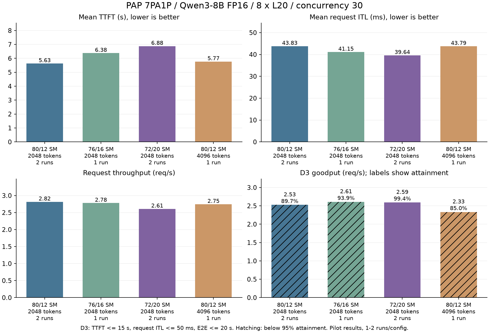

# 当前 PAP 的性能瓶颈与优化方向

后续校正：在固定输入的 12 SM 带宽测量中发现了 PAT 分段编号冲突，已在独立
依赖中修复并通过 reference 检查，见
[带宽报告](../../microbench/PAP-20260907-ATTENTION-BANDWIDTH/README.md)。该缺陷
可能影响本页旧运行，尚未逐 plan 追溯；本页原始观测继续保留，但暂不将旧 PAT
结果作为正确性已验证的性能基准。此前的服务审计和输出长度检查没有覆盖这一错误。

2026-09-07。结论针对 **Qwen3-8B FP16、8 张 L20、7PA1P、native 32K、并发 30**。

**TTFT 的主要耗时仍在 Prefill 排队和处理；ITL 则同时受 Projection 路径、最慢
Attention 分片和两者之间的往返影响。KV 回收仍不够及时，但本轮没有证据表明
KV 容量不足是 TTFT 的主要原因。**

这次没有找到同时改善 TTFT、ITL 和吞吐的配置。72/20 组合的两次运行均观察到
平均 ITL 下降、TTFT 上升，但 Decode 负载也随之改变，不能把 ITL 收益直接归因于
Attention kernel 获得更多 SM。要继续同时改善二者，重点应该转向 Prefill
调度与控制路径、Attention 负载不均衡，以及 Projection 的每步执行成本。

## 实验结果：先看取舍

六次不启用诊断的运行，共 1080 个请求；另外一次带原生 GPU 时间记录器的诊断
完成 180 个请求。正式表格只使用前六次。每次独立启动、180 请求、60 会话 × 3 轮。

| Prefill/Attention SM | Prefill token 预算 | 重复次数 | TTFT 均值 (s) | ITL 均值 (ms) | 吞吐 (req/s) |
| --- | ---: | ---: | ---: | ---: | ---: |
| 80/12，当前配置 | 2048 | 2 | 5.632 | 43.834 | 2.816 |
| 76/16 | 2048 | 1 | 6.379 | 41.150 | 2.780 |
| 72/20 | 2048 | 2 | 6.882 | 39.641 | 2.609 |
| 80/12 | 4096 | 1 | 5.774 | 43.794 | 2.746 |

72/20 相对当前配置：平均 ITL 下降 **9.6%**，TTFT 上升 **22.2%**，吞吐下降
**7.3%**。两次运行均出现同方向的平均延迟变化。76/16 是中间取舍，只有一次样本。
4096 token 预算没有显示整体收益，ITL 的微小差异小于基线两次之间的波动。

### 因果解释修正：Prefill 变慢也可能让 Decode 更轻

用户指出的另一条路径成立：Prefill 资源减少 → 请求更晚进入 Decode → 活跃
Decode 请求变少 → Attention 工作量减小 → ITL 降低。此前把 ITL 改善过多归因于
Attention 配额增加，证据不足。两次重复只能复现整个配置变化的结果，不能分离
这条间接路径与 kernel 本身加速的直接路径。

复核两组各 360 个请求及服务端计数：

| 指标 | 80/12 | 72/20 | 变化 |
| --- | ---: | ---: | ---: |
| 每个活跃 PA-step 的平均请求行数 | 1.783 | 1.596 | -10.5% |
| 客户端生成阶段平均并发代理量 | 10.020 | 8.396 | -16.2% |

第一行由七个 PA 的 `offload_exec_peer_rows` 总和除以
`offload_exec_peer_batches` 总和得到，是 PA 子 batch 的步数加权均值，不是全局
Projection batch 大小。第二行是所有请求的 `(request_latency - TTFT)` 秒数之和
除以 benchmark duration，是客户端时间定义的代理量，不是 GPU batch 实测值。
两轮均呈现同方向变化，说明两组没有保持相同 Decode 工作形状。

这些数据仍不能证明负载下降全部来自 Prefill 变慢：Attention 如果更快，也会
缩短请求停留时间、降低活跃并发。必须固定 batch、上下文长度、KV 物理复用布局、
backend 和输入，单独测 12/20 SM 的 Attention kernel；再在 80/12 的完整 PAP 上
验收 12 SM 优化。当前 **9.6% 是整体请求 ITL 的配置差异，不是纯 kernel 加速率**。
复算见 [confound_check.py](confound_check.py) 和 [数据](decode_load_confound.json)。



尾延迟采用合并请求记录上的线性百分位；ITL 分位数是**请求平均 ITL**的分位数，
不是逐 token gap 的分位数。

| 配置 | TTFT P95 / P99 (s) | ITL P95 / P99 (ms) |
| --- | ---: | ---: |
| 80/12，2048 | 9.639 / 11.904 | 53.379 / 55.540 |
| 76/16，2048 | 10.207 / 11.979 | 50.181 / 52.111 |
| 72/20，2048 | 10.735 / 13.060 | 44.943 / 46.817 |
| 80/12，4096 | 9.668 / 12.357 | 54.097 / 54.949 |

逐轮结果保留了波动，不能只看合并均值：

| Run | TTFT (s) | ITL (ms) | 吞吐 (req/s) | D3 合格请求 |
| --- | ---: | ---: | ---: | ---: |
| baseline_r1 | 5.645 | 44.137 | 2.880 | 143/180 |
| baseline_r2 | 5.620 | 43.531 | 2.754 | 180/180 |
| attention16_r1 | 6.379 | 41.150 | 2.780 | 169/180 |
| attention20_r1 | 6.953 | 39.325 | 2.619 | 179/180 |
| attention20_r2 | 6.810 | 39.957 | 2.598 | 179/180 |
| budget4096_r1 | 5.774 | 43.794 | 2.746 | 153/180 |

## TTFT：大头在 Prefill，尚未证明是纯 GPU 计算瓶颈

一个 request 是一个会话轮次。Prefill iteration 是调度器的一次迭代，可以处理
请求的一段 prompt；一个长请求需要多次 iteration。Decode step 是当前活跃
Decode batch 前进一次。排队、GPU 执行、执行后处理和向客户端交付是不同边界。

请求的预期路径是：

```text
客户端发送
  → Gateway 输入处理、分词、路由、Attention 注册
  → Prefill HTTP → EngineCore 入队 → 首次调度 → 一个或多个 Prefill chunk
  → prompt KV 就绪 → Projection admission → Decode → 首 token → 最后 token
  → Attention 退休 → Prefill 应用最终 commit、释放 lease → allocator 回收
```

诊断运行 `diagnostic_80_12_v2` 的 180 个请求全部与 Gateway 日志匹配：

| 实测边界 | 平均耗时 |
| --- | ---: |
| 客户端 TTFT | 5.615 s |
| Gateway 发起 Prefill HTTP 到收到 Prefill 响应 | 5.047 s |
| Prefill 首次 QUEUED 到首次 SCHEDULED | 2.222 s |
| 首次 SCHEDULED 到 Prefill NEW_TOKEN | 2.545 s |
| KV readiness 检查 | 2.0 ms |
| Projection admission 等待 | 0.016 ms |
| admission 后到 Gateway 首个流式 chunk | 131.4 ms |

**约 90% 的 TTFT 在 Prefill HTTP 路径内。** 内部排队与驻留之和为 4.767 s，
与 HTTP 区间的差约 0.279 s；这个差值尚未拆分，不能直接命名为某一种开销。
2.545 s 是含 chunk 间等待的驻留时间，不能当作 CUDA kernel 时间。

指标采样中，各 PA 的 running 请求数峰值均为 1，waiting 峰值最高为 4。
当前调度器先分配 RUNNING 请求的 token：若一个长请求用完本轮 2048 token
预算，新请求即使有空闲 KV，也要等待后续轮次。这是
[Scheduler.schedule](../../../../../vllm/v1/core/sched/scheduler.py) 中可确认的行为；
本次没有逐 iteration 的请求状态记录，尚不能断言哪些尾延迟请求由这个条件造成。

**下一步优先验证：总预算保持 2048，只限制单请求每轮可占用的 token 数，给新到达
或剩余 Prefill 较短的请求留出调度机会。** 例如测试单请求上限 1024，并记录每个
request 的首次调度、每个 chunk 的提交与完成。需要同时检查长请求是否被饿死、
总 GPU 工作量和吞吐，不能只优化首次排队这个指标。

第一轮请求的入口开销也更高：Gateway 分词、路由、注册三个 wall-time 区间均约
207–215 ms；后续轮次分词约 30–37 ms，路由和注册约 1–2 ms。这些区间包含线程池
或事件循环等待，不是对应函数的纯 CPU 时间。它是次级候选，不能解释全部 5 s。

依据：[Gateway 阶段分析](runs/diagnostic_80_12_v2/gateway_analysis.json)、
[Prefill 指标与分析](runs/diagnostic_80_12_v2/analysis.json)、
[原始 metrics](runs/diagnostic_80_12_v2/prefill_metrics.jsonl)。

## KV 回收：还有延迟，但不能继续把全部排队归因于它

诊断中，180 个客户端结束事件都匹配到同一请求的 allocator 回收日志。
平均回收延迟位于 **0.487–1.487 s**；最迟的一条位于 **2.487–3.487 s**。
这是日志只有秒级精度形成的上下界，**不是统计置信区间**。回收可以先于客户端
收到最后的数据，所以部分单请求差值为负是允许的。

已实现的修复仍有效：最终 commit 应用到正确 Prefill owner，lease release 后通过
同步边界收集完成状态，再将 finished_sending 交回 allocator。本轮完成了 180 次
回收，内部 commit、token join、生命周期清理审计通过。

仍可改善的路径是：

```text
上一条控制消息已提交，Dispatcher 正在等待其 EngineCore 返回
  → 新的 commit/release 到达，进入 Dispatcher 队列
  → 前一条返回，才提交下一条
  → EngineCore 在允许处理 utility 的边界应用操作
  → release 的回收路径还要确认 Prefill worker 完成
```

[PAPControlDispatcher._run](../../../../../vllm/pap/prefill_control_router.py)
仍逐条等待 utility；[回收路径](../../../../../vllm/pap/integration/engine.py)
包含设备同步和 worker completion 收集。**批量处理兼容的退休操作、让每次安全
边界处理完已有队列**是明确的实现候选。但当前日志没有 enqueue/submit/apply/ack
的同 ID 高精度边界，不能把上述约一秒全部算到 Dispatcher 上。

同时，本轮 KV 占用采样峰值约 53.1%，Prefill preemption 为 0。因此没有证据表明
本轮主要被 KV 用尽卡住；采样也不能排除很短的瞬时阻塞。Prometheus 的
`waiting_by_reason=capacity` 在本版本中来自普通 waiting 队列长度，**不是
“KV 分配失败”的专用计数**，见 [metrics logger](../../../../../vllm/v1/metrics/loggers.py)。

七个 Attention 的 Decode 容量扩展请求、等待和失败计数均为 0。这组数据最大输出
239 token，没有触发动态 runway 扩容等待。因此改 256-token 扩容粒度不是本轮
有证据支持的优化方向。长输出和 KV 接近饱和的场景需要另外构造实验。

依据：[逐请求回收连接记录](runs/diagnostic_80_12_v2/reclaim_join.json)，记录保留了
请求 ID、客户端时间、原始日志路径和行号。

## ITL：Projection 固定成本与最慢 Attention 都重要

原生记录器保存了 585 个七个 PA 都活跃、且下一 step 有效的样本。通过
Projection step → PA local epoch 对齐所有 Attention 记录，并核对 request_count。
这些样本的活跃 Decode 请求平均约 13 个，**不是客户端并发数 30**。

| 同一组 585 个 step 的观测 | 均值 |
| --- | ---: |
| 35 段层间 Projection 路径时间之和 | 20.358 ms/step |
| 36 层 QKV 派发开始到 gather 完成的时间之和 | 21.614 ms/step |
| 每层最慢 PA 的 Attention kernel 区间，累计 36 层 | 16.008 ms/step |
| 上述往返区间减最慢 kernel 区间的残差 | 5.607 ms/step |
| 每层最慢 PA 与 PA 平均 kernel 时间之差，累计 36 层 | 5.463 ms/step |

另取有相邻记录的 570 对 step，直接用同一 Projection GPU 的相邻首层开始时间
相减，平均 cadence 为 **44.661 ms**；最后 gather 到下一个 step 首层开始平均
**2.664 ms**。这些是 GPU 时间线上的量，不能替代请求平均 ITL。

具体含义：

- **Projection 有显著的每步成本。** 20.358 ms 包含层间模型操作与相关准备，不能
  全部算作 GEMM，也未用硬件计数器证明 HBM 带宽饱和。当前是小 Decode batch，
  若研究微批流水，需要计入额外 Projection 执行和权重读取，不能假设拆成两半就
  能减半延迟。既有独立投影微基准也记录了拆分的额外成本，见
  [Projection probe](../../microbench/PAP-20260905-RESEARCH-DIAGNOSIS/projection_backbone.md)。
- **最慢 PA 会影响整个 batch 前进。** 当前每层 gather 等待各活跃 PA 的结果，
  然后继续 Projection；见 [执行路径](../../../../../vllm/pap/model/projection.py)
  和 [gather kernel](../../../../../vllm/pap/transport/nvshmem/device_bridge.cu)。
  5.463 ms 是负载不均衡的观测指标，不是能直接兑现的加速量。
- **仍有未解释的往返成本。** 5.607 ms 混有 pack/put、KV append、就绪等待、同步
  和 scatter，不能称为“纯网络延迟”。首层往返平均 1.710 ms，后续层通常约
  0.56–0.58 ms，首层额外区间值得加边界追踪，尚未确认机制。

PA 的绝对 GPU 时间戳没有跨设备相减；只连接身份并比较各自的时长。585 个样本
是所有 PA 活跃的子集，不能代表启动、排空或部分 PA 活跃时的全部表现。
3265 个单请求 PA-step 通过 active/leased block 数与 unique block 数相等检查；
这项检查不是完整数值正确性或模型质量评测。

原始证据：[Projection trace](runs/diagnostic_80_12_v2/pa_trace.pt)、同目录七份
`attention_pa_*_kernel_trace.pt`、[对齐分析](runs/diagnostic_80_12_v2/analysis.json)。

## 为什么当前路由仍有优化空间

当前 Dynamo 路由已经跟踪缓存、Prefill token 和活跃 Decode 负载，不能说它完全
“不知道 Decode”。但它没有直接使用本轮测到的逐 PA Attention kernel 时间反馈。

不同上下文长度、请求数和物理 prefix 复用，会造成不同 Attention 服务时间。
下一步应验证**按 Attention 预计完成时间平衡 PA**是否优于当前负载代理，同时计入
换 PA 导致的 Prefill cache miss。先研究新请求/下一轮的放置；跨 PA 搬迁活跃 KV
涉及额外传输、所有权与 Graph metadata，不应从当前差值直接推导值得实现迁移。

这仍是待验证方向。本轮没有修改路由器，也没有证明 5.463 ms 不均衡全部能通过
路由消除。参考当前 [Dynamo 接口](../../../../../vllm/pap/gateway/dynamo_routing.py)。

## Goodput：配置选择取决于 SLO

沿用之前的**诊断阈值**，不宣称它们是产品正式 SLO：

- D2：TTFT ≤ 10 s，ITL ≤ 75 ms，E2E ≤ 20 s。
- D3：TTFT ≤ 15 s，ITL ≤ 50 ms，E2E ≤ 20 s。
- 每个请求必须同时满足三个阈值；合并 goodput = 合格请求数 / 各轮 benchmark
  duration 之和；另以 95% 请求合格率判断可行性。

| 配置 | D2 合格率 | D2 goodput (req/s) | D3 合格率 | D3 goodput (req/s) |
| --- | ---: | ---: | ---: | ---: |
| 80/12，2048 | 345/360，95.8% | 2.698 | 323/360，89.7% | 2.526 |
| 76/16，2048 | 167/180，92.8% | 2.579 | 169/180，93.9% | 2.610 |
| 72/20，2048 | 329/360，91.4% | 2.384 | 358/360，99.4% | 2.594 |
| 80/12，4096 | 172/180，95.6% | 2.624 | 153/180，85.0% | 2.334 |

按合并样本和 95% 门槛：D2 下当前 80/12 配置更合适；D3 下只有 72/20 达到门槛。
76/16 的 D3 原始 goodput 略高，但没有达到 95% 合格率，不能据此称为可行性最优。

72/20 的 D3 goodput 合并后仅比当前配置高 **2.7%**，不是首轮看起来的约 14%。
基线自身两轮 D3 合格率为 79.4% 和 100%。这些是一到两次重复的探索结果，
还没有建立 goodput 小幅差异的统计稳定性，也没有测最大可持续负载。

## 接下来怎么做

| 优先级 | 候选工作 | 本轮依据 | 下一项能证伪它的实验 |
| --- | --- | --- | --- |
| 1 | Prefill 新请求调度机会、短剩余工作优先 | 平均首次排队 2.222 s；总 Prefill 路径约占 TTFT 90% | 总预算 2048 不变，限制单请求 chunk，记录同 ID 的调度/提交/完成；检查 TTFT、吞吐及长请求尾部 |
| 2 | 退休控制批处理与及时回收 | 客户端结束后仍有约一秒回收滞后；Dispatcher 串行等待 | 先记录 enqueue/submit/apply/ack/reclaim，再只改变批处理；同测 C30 与高 KV 压力，确认 TTFT 是否真的受益 |
| 3 | Attention 耗时感知的 PA 放置 | 最慢 PA 与平均 PA 的 kernel 时间差明显；SM 配额实验影响 ITL | 固定 80/12、同 workload，只改变放置成本函数；同时检查 cache hit、最慢 PA 和 TTFT |
| 4 | Projection 每步成本及合法重叠 | 35 段层间路径约 20.36 ms | 先补可用的 GPU profiler/硬件计数；再比较投影算子、权重精度或微批方案，计入额外工作与精度回归 |
| 5 | 首层派发/就绪与 Gateway 冷突发 | 首层往返显著高于后续层；首轮入口更慢 | 同 step 的控制准备、GPU replay、QKV 到达、kernel 开始和返回信号边界追踪 |

如果当前优先目标是 TTFT 和整体吞吐，保留 80/12。72/20 可以作为严格 ITL 阈值的
候选配置，不能替代整个 PAP 默认配置。**本 worktree 没有修改生产运行时代码。**

## 复核、范围和未完成的测量

- Worktree：`/tmp/vllm-pap-bottleneck-20260907`；分支：
  `research/pap-bottleneck-20260907`；源提交：`6b45c541ea`。
- 模型 FP16、TP1、max length 32768、无 YaRN；7 个 Prefill、7 个 Attention、
  1 个 Projection、8 个 EngineCore。每个 PA 的两个进程通过 MPS 分区 UUID
  对应物理 GPU 0–6，Projection 使用 GPU 7；MPS 内 `CUDA_VISIBLE_DEVICES=0`
  是局部编号。启动 context 和真实进程快照已核对。
- `requested.json` 保存实验环境，`effective_config.env` 保存共享 runner 解析结果，
  `protocol.py` 保存当次运行协议。实际服务模块来自这个 worktree；复用既有 venv
  和已构建扩展，NVSHMEM 单独复制，bridge 在 worktree 对应的独立目录构建。
- 正式配置差异只有 SM 划分或 Prefill token 预算，以及运行路径；见
  [有效配置差异](effective_config_differences.json)。预算同时传给 Gateway 的
  Dynamo 配置，因此 4096 实验不能单独证明 GEMM 计算效率的变化。
- 原始数据集 SHA256 为
  `5d4357a9a037e9e1a3c25acf402ba06afd1c9e7643678da225b9f5cc63cb257c`，
  与此前 C30 归档一致。全部成功运行核对了相同会话/轮次及输出长度；多轮 prompt
  包含实际生成反馈。结果只覆盖这一固定数据集和 C30，不外推到 C60 或长输出。
- 原始逐请求指标、token chunk 间隔、DCGM 时间序列、服务日志和审计均保存在
  `runs/<run>/`。GPU telemetry 使用客户端请求窗口；高 GPU utilization 不能区分
  Prefill、Attention、Projection 计算和等待信号 kernel，不能单独证明算力饱和。
- `diagnostic_80_12_v2` 使用现有原生记录器和只读 metrics 采样；不与正式配置合并。
  第一轮 collector 与进程快照在服务启动期间单独启动，采样在客户端开始前已经
  生效；最终 `run.py --trace` 已将该流程收进协议。
- 一次数据哈希预检因协议中录入错误而停止，依据既有归档和数据清单纠正；没有
  启动工作负载。另一次 `diagnostic_prefill8` 在启动前以 exit 2 被拒绝：共享
  [runner](../../../scripts/run_pap_workload.sh) 明确禁止当前 CUDA Graph lane 启用
  `PAP_PREFILL_TORCH_PROFILE`。未绕过保护或改为其他 Graph 配置；失败日志保留。
  最终协议移除了不受支持的选项。**没有取得本轮 Prefill torch trace，因此没有
  kernel 分类、HBM 饱和或 CPU/GPU 空档占比的结论。**
- 生产代码无临时 instrumentation 改动。所有成功运行完成拓扑、Graph、生命周期、
  token join、commit/reclaim 与现有正确性审计；这些不等价于独立模型质量评测。

在此 worktree 根目录启动新的不覆盖历史数据的运行：

```bash
.venv/bin/python benchmarks/pap/experiments/e2e/PAP-20260907-BOTTLENECK/run.py new_baseline
.venv/bin/python benchmarks/pap/experiments/e2e/PAP-20260907-BOTTLENECK/run.py new_attention20 --attention-chunks 5
```

`--attention-chunks 4` 对应 76/16，`--prefill-budget 4096` 对应预算实验，
`--trace` 启用原生诊断。复算时向 [analyze.py](analyze.py) 传入成功的 `runs/<run>`
目录；脚本检查请求数、输出长度、回收匹配、GPU 覆盖及 trace 对齐。
[comparison.json](comparison.json) 保存逐轮分析；[plot.py](plot.py) 生成图表。

原始运行另归档到 [results/archives](results/archives)，包含七次成功运行和一次
profiler 启动前失败，共 939 个普通文件。归档已逐文件解包读回并校验 SHA256；
[manifest](results/manifest.json) 保留每个文件的大小和摘要。在 `results/` 下执行
`sha256sum -c SHA256SUMS` 可检查归档。全部分析断言和新文件的 pre-commit 检查通过。
最终八张 GPU 均无计算进程、利用率 0%；主工作目录的原有改动未变。
